# Phone UI/UX plan: patterns from the Lovable directory, applied to MusicLinkd

Author: Cowork Claude, for Claude Code. Date: 5 Oct 2026.
Checked against: the musiclinkd repo on main at `0d82ad7` (Mac clone) and the live database.
References: 16 screenshots from the owner (`img/yours-*`) and 22 phone captures I measured live at 412px in Android touch mode (`img/cap-*`).

---

## 0. Ground rules (read first)

1. **Phone first, phone only.** Every spec here is for 412px. Desktop isn't part of this plan.
2. **Update existing components. Don't create new ones.** Section 3 maps every pattern to the component that already exists in the repo. A new file under `src/components/` needs the owner's yes, with a reason why no existing one can carry it. Where this plan finds two components doing one job, the job is to **merge them, not add a third** (section 3.3).
3. **Branch only.** One branch per work package (section 11). **Don't merge to `main` or push `main` until the owner approves each one.** Lovable is tracking `main`. Commit trailer is `Co-Authored-By: Wugweb <admin@wugweb.com>` only. CHANGELOG goes in the same commit.
4. **Owner rules that apply here:**
   - No price on profile or person cards (queue item 8).
   - Booking happens only through a Service Card (item 9).
   - One Inbox (item 10).
   - Message, Connect and Follow are separate actions; none is required before messaging (item 11).
   - Never invent ratings, counts or availability.
5. **Design-system rules that apply:**
   - Inter only, no letter-spacing tuning.
   - Radius 8 / 16 / 32 / pill.
   - Semantic tokens, never raw hex in components.
   - A **48dp tap area** on every control.
   - `:focus-visible` ring on every control.
   - lucide icons, never emoji.
   - Every screen ships loading, empty, error and offline states.
6. **Wording is the owner's.** Labels in this plan are placeholders marked _(copy: owner)_ unless the app already uses them. Show the owner every new string before merging.
7. **Don't take from Lovable:**
   - their font (Camera Plain) and letter-spacing;
   - their gradients, heart mark and blue labels;
   - their wording;
   - "Typical budget" on a profile;
   - the browser's built-in validation bubble.

Done means:

- `bun install`, `bunx tsc --noEmit`, `bun run lint` and `bun run build` all pass;
- the workerd render passes;
- every touched screen is rendered at 412px;
- `roadmap.md` is updated. **Note: there is no `roadmap.md` at the repo root on `main` (`0d82ad7`); copies exist only inside old `.claude/worktrees/`. Ask the owner whether to restore it at the root before ticking this.**

---

## 1. What the owner shared (screenshots)

| #   | Screenshot                                             | What it shows                                                                                                                        | Used in section |
| --- | ------------------------------------------------------ | ------------------------------------------------------------------------------------------------------------------------------------ | --------------- |
| 1   | 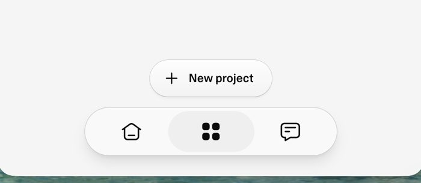       | Floating 3-icon bottom nav with an active pill; **"+ New project" as a labelled floating pill**                                      | 7.1             |
| 2   | 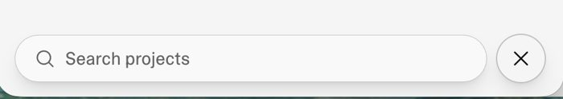                | Search anchored at the bottom, with a round ×                                                                                        | 7.2             |
| 3   | 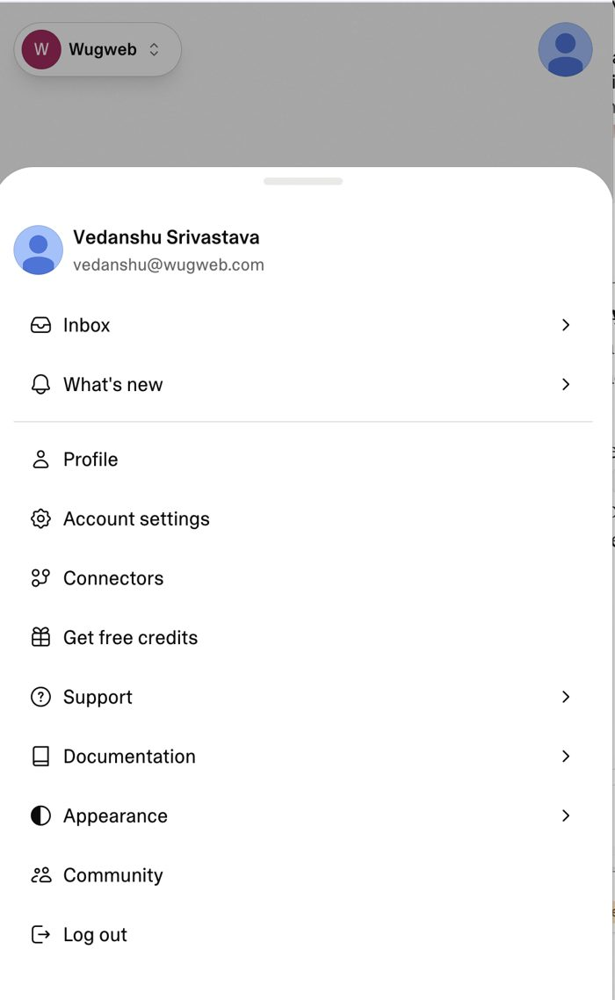                | Account sheet: grab handle, identity header, grouped rows, › only on rows that open a sub-menu; **workspace switcher pill** top left | 7.3, 7.4        |
| 4   | 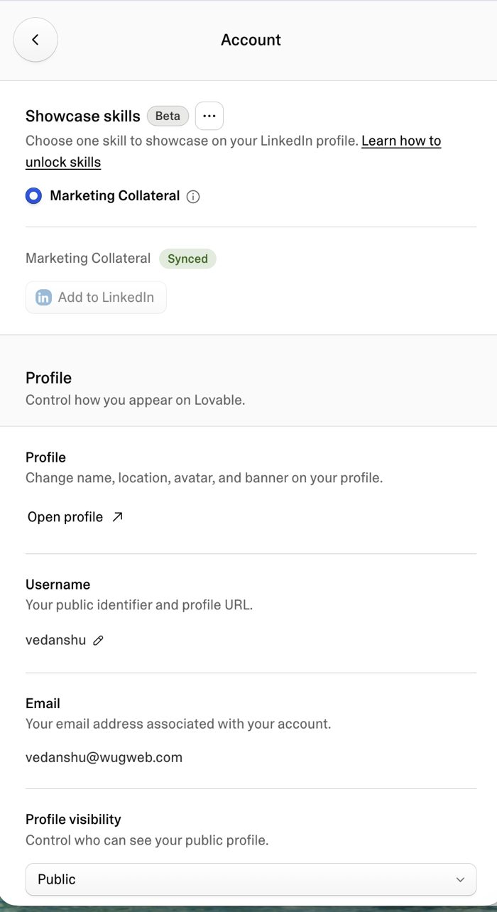             | Settings: grey section header band (title + description), rows with title + description + control                                    | 7.5             |
| 5   | 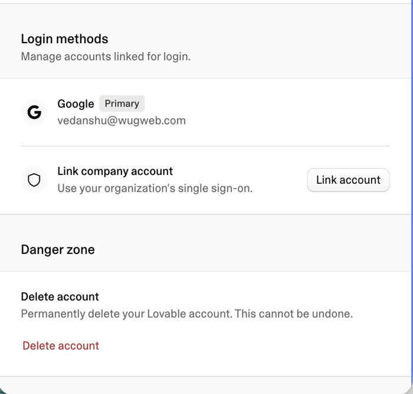    | Login methods with a "Primary" tag; **Danger zone** with a red Delete link                                                           | 7.5             |
| 6   |                      | Re-authentication before 2FA; **Log out everywhere**                                                                                 | 7.5             |
| 7   | 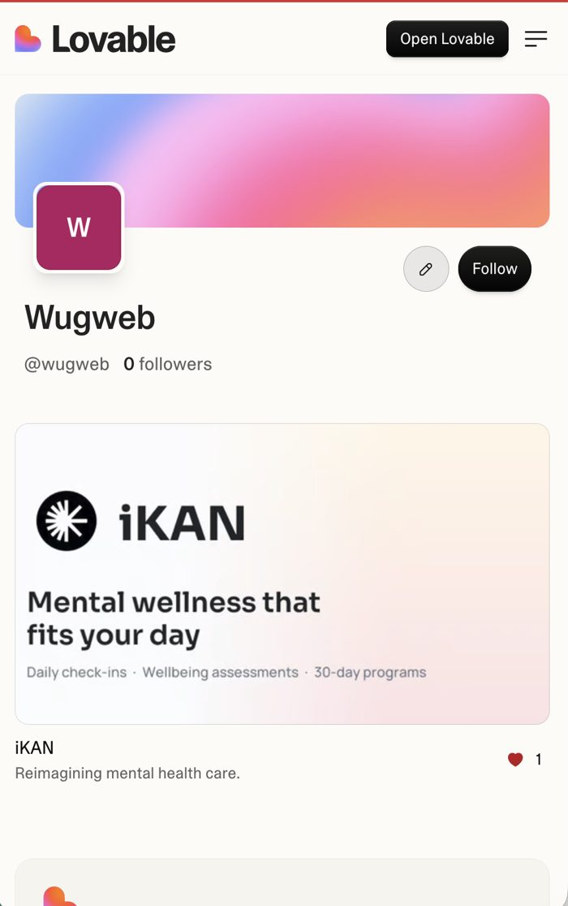        | Profile: banner, square avatar overlapping it, pencil + **Follow**, @handle · followers, project cards with likes                    | 4, 6            |
| 8   | 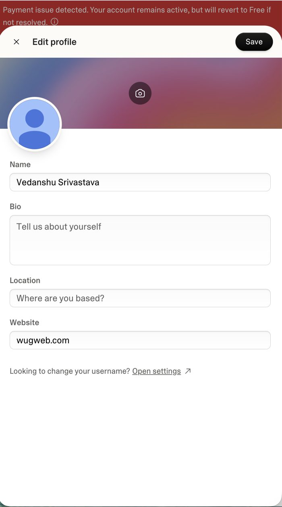           | Full-screen edit sheet: × and Save, camera on banner, cross-link to settings; **account status banner** on top                       | 7.6             |
| 9   | 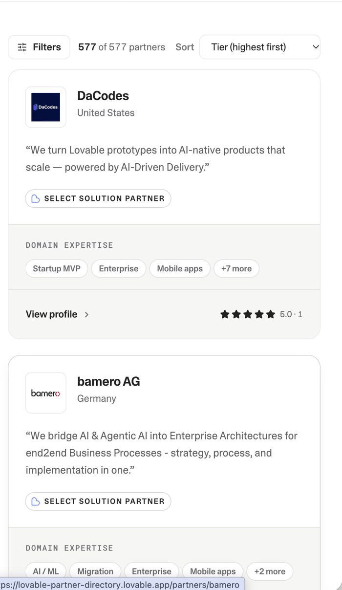                | Directory cards: logo, name, place, tagline, tier pill, chip band with "+N more", footer with "View profile" and rating              | 3, 4            |
| 10  | 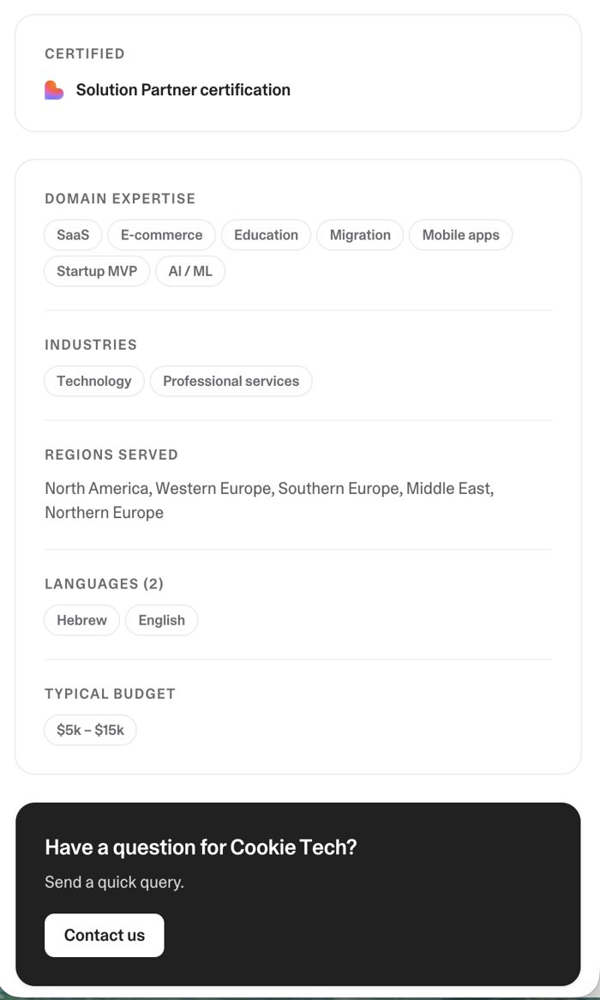 | Profile chip groups, **"Typical budget" (don't take)**, dark "Have a question?" card                                                 | 6               |
| 11  | 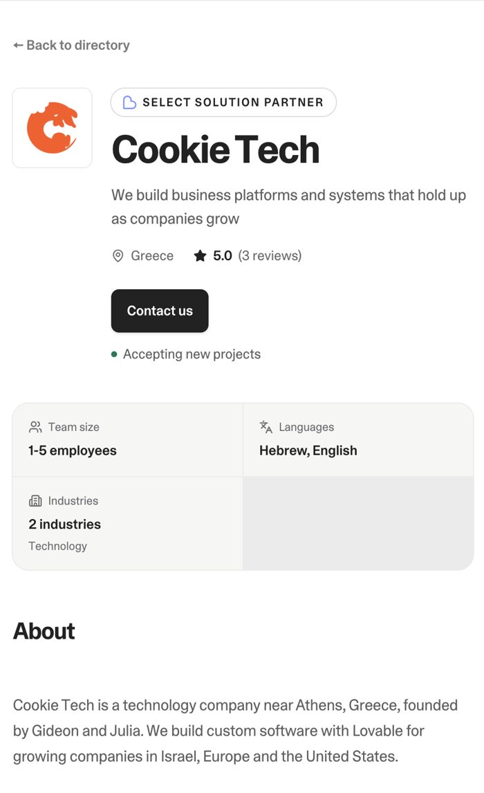       | Profile header: tier pill, name, tagline, location · rating, one CTA, availability dot, fact grid                                    | 6               |
| 12  | 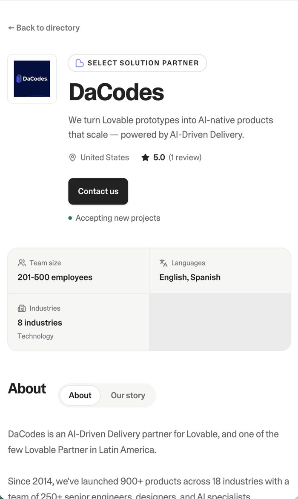      | Same, plus the **About / Our story pill switch**                                                                                     | 6               |
| 13  | 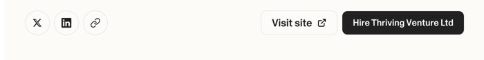          | Footer: social icon circles, "Visit site", **button that names the entity**                                                          | 6               |
| 14  | 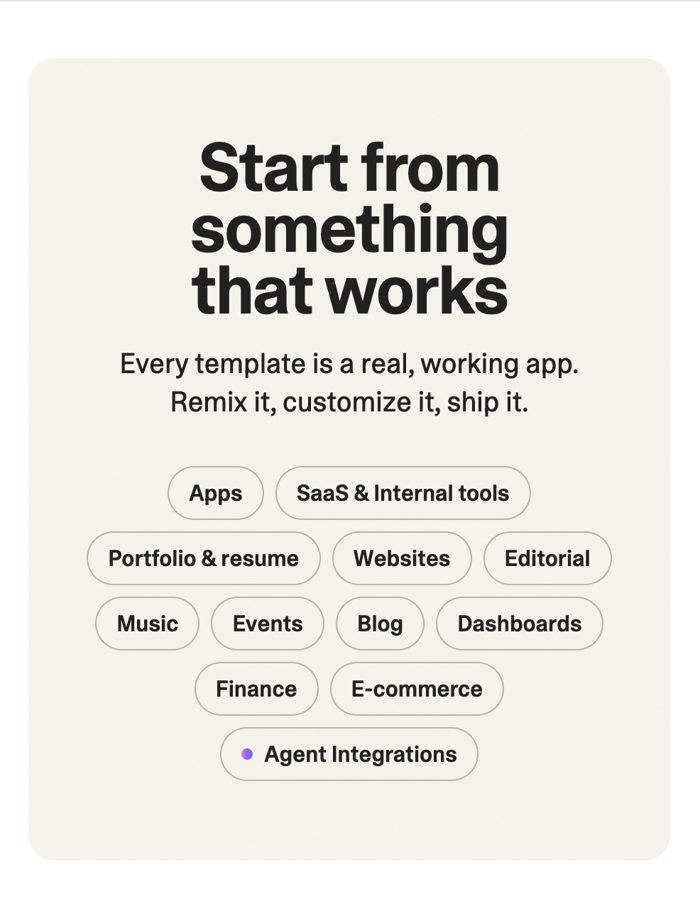         | Centred category chips that wrap                                                                                                     | 5               |
| 15  |         | Header: logo, search, AI sparkle, more                                                                                               | 7.2             |
| 16  | 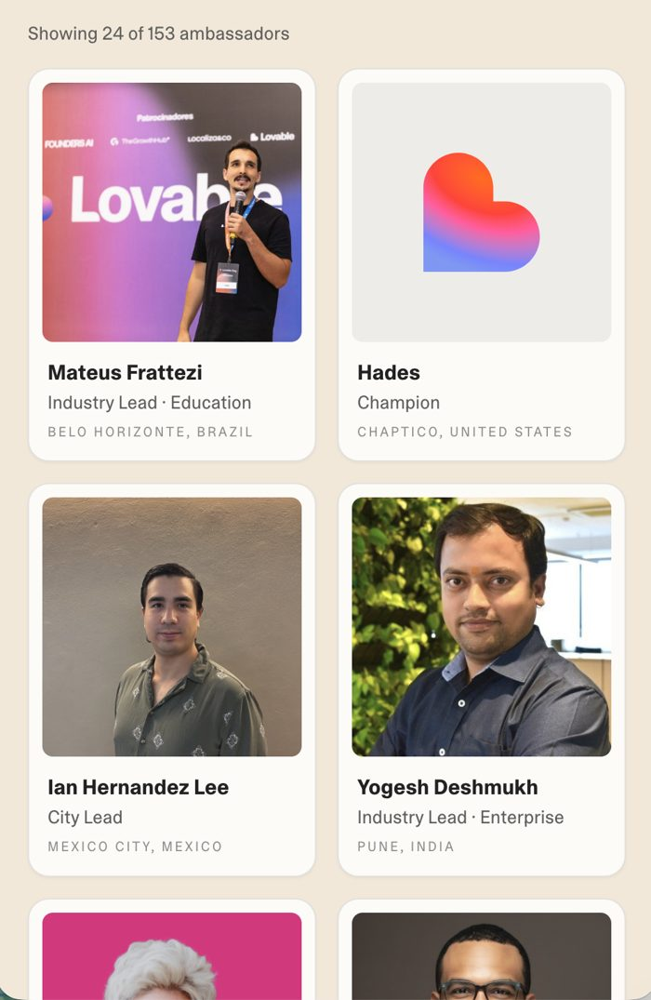                 | 2-column people cards: photo, name, role · specialty, location in small capitals; brand mark when there's no photo                   | 4               |

---

## 2. Measured foundations (phone, 412px)

Map each value to an **existing** token in `src/styles.css`. Add a token only where noted, and only with the owner's yes.

| Measured on Lovable | Value                                                                          | Existing MusicLinkd token             | Action                                                                                                    |
| ------------------- | ------------------------------------------------------------------------------ | ------------------------------------- | --------------------------------------------------------------------------------------------------------- |
| Ink                 | `#1C1C1C`                                                                      | `--ink` / `--color-ink`               | Keep ours                                                                                                 |
| Secondary text      | ink at 72% (body) / 60% (labels) / 30% (placeholder)                           | `--muted-foreground`                  | Check that our muted text uses one ink-opacity ladder, not unrelated greys. **Report; don't add tokens.** |
| Meta text           | `#6B6B70`                                                                      | `--muted-foreground`                  | Map                                                                                                       |
| Grey surface        | `#F6F6F5`                                                                      | `--surface-subtle` / `--color-subtle` | Map                                                                                                       |
| Hairline            | 1px **ring** `rgba(0,0,0,.08)` drawn with box-shadow, not a border             | `--border`                            | Use our border colour as a ring (`ring-1 ring-border`) on cards and inputs. No new token.                 |
| Raised list card    | ring `.14` + `0 6px 20px -8px rgba(0,0,0,.12)`                                 | `--shadow-elevation-2`                | Map                                                                                                       |
| Radius              | 8 controls · 16 cards and panels · pill chips and tabs                         | `--radius-sm` / `--radius-lg` / full  | Map. Their 12 and 6 are stray values: **don't copy**.                                                     |
| Type order          | 40/44 page title · 24 section · 18 card title · 16 body · 14 UI · 12 meta      | `--text-1…` fluid steps               | Map onto existing steps; no new step                                                                      |
| Main button         | 44px (12/16 padding); 56px pill for the main action on marketing-style screens | `Btn` sizes                           | Visual size only. **Tap area 48dp minimum.**                                                              |
| Compact control     | 32px (Filters, Sort, selectable chips)                                         | `Chip`, `IconBtn`                     | **Their tap area is too small.** Keep the visual size, add an invisible 48dp tap area.                    |
| Input               | 44px, radius 8, padding 12/16, **16px text**, focus = 1.5px ink ring           | `ui/input.tsx`, `--focus-ring`        | Copy exactly. 16px text stops phones zooming in.                                                          |
| Error               | red `#FF003B`, 14px (500) message under the field, red border                  | `--destructive`                       | Map                                                                                                       |

---

## 3. Components: update existing, never add new

### 3.1 Map of patterns to existing components

| Lovable pattern                           | Existing MusicLinkd component (file)                                                                            | Change                                                                                                    |
| ----------------------------------------- | --------------------------------------------------------------------------------------------------------------- | --------------------------------------------------------------------------------------------------------- |
| Directory card (img 9, cap-01)            | `PersonCard`, `PersonRow`, `BookableCard`, `BookableRow` (`src/components/ml/cards.tsx`)                        | Card anatomy and action footer (section 4); no price                                                      |
| Card skeletons                            | `PersonCardSkeleton`, `PersonRowSkeleton`, `BookableCardSkeleton` (`cards.tsx`)                                 | Use them for loading; never show a "0 of 0" count                                                         |
| Rating "5.0 · N", only when reviews exist | `RatingLine` (`cards.tsx`), `Stars` (`kit.tsx`)                                                                 | Keep the rule; merge duplicates (3.3)                                                                     |
| Chips with counts, selectable             | `Chip` (`ui.tsx`)                                                                                               | Add an optional `count`; selected = ink fill and `aria-pressed`                                           |
| Pill-track switch (img 12)                | `Segmented` / `SegmentedField` (`kit.tsx`)                                                                      | Match the spec: grey track with 4px padding, active = white pill, `role=tab` + `aria-selected`            |
| Filters panel (cap-05…08)                 | `Sheet` (`ui.tsx`) + `DrawerList`, `DrawerSearch`, `DrawerOptionRow`, `SheetSectionHeading` (`drawer-list.tsx`) | Add multi-select with counts, search inside a group, "Show N more", footer "Clear all" + "Show N results" |
| Search field + clear ×                    | `SearchBar` (`ui.tsx`), `SearchField` (`tab-header.tsx`)                                                        | Merge into one (3.3); save the query in the address                                                       |
| Project card (cap-14)                     | `WorkCard`, `WorkLinkRow` (`portfolio.tsx`)                                                                     | Add the public "card" layout (section 5.3); add a Like action                                             |
| Media playback in the card                | `MediaEmbed` (`media-embed.tsx`)                                                                                | No change                                                                                                 |
| Save                                      | `SavedToggle` (`saved-toggle.tsx`)                                                                              | Keep; Save stays separate from Like                                                                       |
| Fact grid (img 11, cap-13)                | `InfoRow`, `ProfileSection` (`profile.tsx`)                                                                     | Change the layout to a 2-column grid with gap-as-divider (section 6)                                      |
| Chip groups on profile (img 10)           | `ChipGroup`, `ChipGroupList`, `TagChip` (`profile.tsx`)                                                         | Labels in our eyebrow style; no letter-spacing                                                            |
| Long text with "more"                     | `ClampedText` (`profile.tsx`)                                                                                   | No change                                                                                                 |
| Empty / loading / error / offline         | `EmptyState`, `StateCard`, `Loading`, `LoadError`, `OfflineBanner` (`kit.tsx`)                                  | Empty state **must offer an action** ("Clear filters", copy: owner)                                       |
| Popup / quick look (cap-22)               | `ui/dialog.tsx`, or `Sheet` on phone                                                                            | Use these, not hand-built; focus trap, Escape, scroll lock                                                |
| Section heading + "see all"               | `SectionHeader` (`ui.tsx`)                                                                                      | Add the optional count line ("Showing 24 of 153")                                                         |
| Bottom nav (img 1)                        | `BottomNav`, `AppNav`, `navItems` (`ui.tsx`)                                                                    | Section 7.1                                                                                               |
| Avatar placeholder                        | `PersonAvatar` (`person-avatar.tsx`), logo-on-ink pattern                                                       | Brand mark when there's no photo (img 16)                                                                 |

### 3.2 What needs a new file? Nothing in phase 1.

Every pattern above fits an existing component. If one doesn't, stop and ask.

### 3.3 Duplicates found: merge, don't extend

| Same job, two or more components | Where                                                                        | Merge into                                   |
| -------------------------------- | ---------------------------------------------------------------------------- | -------------------------------------------- |
| Status pill                      | `StatusPill` (`kit.tsx`) **and** a private `StatusPill` (`portfolio.tsx`)    | `kit.tsx`                                    |
| Rating                           | `RatingLine` (`cards.tsx`), `Stars` (`kit.tsx`), `Rating` (`market.tsx`)     | One rating component                         |
| Save                             | `SavedToggle` (`saved-toggle.tsx`) and `SaveButton` (`market.tsx`)           | `SavedToggle`                                |
| Follower count                   | `Followers` (`market.tsx`)                                                   | Fold into the card action footer (section 4) |
| Search field                     | `SearchBar` (`ui.tsx`) and `SearchField` (`tab-header.tsx`)                  | One                                          |
| Already in AGENTS.md             | `AvailabilityBadge` / `StatusPill`, `Chip` / `Segmented`, `Sheet` / `Dialog` | As AGENTS.md says                            |

Report each merge with before and after call sites. No visual change unless the spec here asks for one.

---

## 4. Cards: add Connect / Follow (owner, 5 Oct)

**Gap:** no person card or business card has a Connect or Follow action. Today:

- `PersonRow` has only `SavedToggle`;
- `PersonCard` and `BookableCard` have no actions;
- the server functions already exist: `requestConnection` and `setFollowing` (`src/lib/connections.functions.ts`).

**Rule (owner, item 11):**

- Person → **Connect** (the person-to-person professional relationship).
- Business / band / other collaboration → **Follow** (an audience relationship).
- Don't hard-code by entity type. A person can be followed too, where the profile allows it. Message never requires either.

**Card structure** (fixes a real HTML problem):

- The card body is the link to the profile. **Actions go in a footer band that sits next to the link, not inside it.** A button inside a link is invalid HTML and breaks screen readers. Lovable uses the same footer band (img 9, cap-01).
- Footer layout: primary action on the left (Connect or Follow), then `SavedToggle`, then the rating on the right (only when real).
- Every action gets a 48dp tap area, even when it looks 32px.

**Action states (labels: copy owner):**

| Relationship                      | States                                                                       | Server                       |
| --------------------------------- | ---------------------------------------------------------------------------- | ---------------------------- |
| Connect (person)                  | none → **request sent** (pending) → **connected**; incoming request → accept | `requestConnection` (exists) |
| Follow (business / band / person) | not following ⇄ **following**                                                | `setFollowing` (exists)      |
| Signed out                        | The action links to `/welcome`, the existing pattern in `talent-profile.tsx` | —                            |
| Your own card                     | No action                                                                    | —                            |

- **Optimistic update with rollback on error**, plus a toast on failure.
- **Counts are real or hidden**, never estimated.
- **Gap (item 11): bands can't be followed today.** `follows.target_id` points at `profiles`, and a band is a `collabs` row. **Ask the owner before any schema change.** Until then, band cards show no Follow button; never one that does nothing.

**Cards in scope:** `PersonCard`, `PersonRow`, `BookableCard`, `BookableRow`, plus the business card (section 5.1).

---

## 5. Discover (owner, 5 Oct)

Live today (`src/routes/discover.index.tsx`):

- modes **For you / People / Opportunities / Studios** (business users see Talent instead of People);
- people come from the directory;
- businesses appear **only as bookable spaces** (`dbStudios`, 22 rows);
- **"Trending work"** is a list of `WorkLinkRow`s (queue item 3 already shipped);
- `listNewWork` exists but is used only by `discover.$slug`.

Live data: **3 business pages** (`profiles.owner_id` set), **146 people**, **240 of 241 portfolio items published**. The public-read rule (RLS) already allows anyone to read published portfolio items. By kind: track 145, project 47, album 13, performance 13, video 16, credit 6.

### 5.1 Show every business profile card

- Discover gets a section for **all business pages**, not only bookable spaces. Source: the existing **`listPublicBusinesses`** in `src/lib/profile-groups.functions.ts`. No new data layer.
- Card: **the existing business card in `cards.tsx`** (the `BookableCard` family; the file comment calls it the "business card"). Extend it to take a business profile without a bookable. **Don't create a new card.** A business with no photo shows the logo-on-ink placeholder.
- Action: **Follow** (section 4). No price (item 8).
- The persona/type filter uses **chips with real counts in one sideways-scrolling row** (cap-20 pattern), through `Chip` with `count`.
- Long lists show **"Showing N of M" and "Show more"** (24 per page; cap-20), using `SectionHeader` plus the count line.

### 5.2 A public feed of all portfolio work: Trending · New · Music · Video

- One section with a chip row: **All · Trending · New · Music · Video** _(copy: owner)_.
  - **Trending** = the existing `listTrendingWork()`.
  - **New** = the existing `listNewWork()`, newest published first.
  - **Music / Video** = filter on `workType(kind).media`, the existing helper used in discover.
- Show **every published item**; nothing private. RLS already enforces `published = true` for the public.
- Card: `WorkCard` in its public layout (5.3). Plays inline through `MediaEmbed`. Kinds that can't play in place show the existing "Open on {site}" card.
- 24 per page + "Show more". Skeletons while loading. An empty state with an action. Offline banner.

### 5.3 Project/work card (public layout) on `WorkCard`

Measured from cap-14:

- The whole card is one tap target. Radius 16, hairline ring, cover image on top (no inner radius), 20–24px padding.
- **Type label** 12px in our eyebrow style (no letter-spacing), **title** 16/24 semibold, **summary** limited to 3 lines, owner name and avatar.
- **Footer band (next to the link, not inside it):**
  - **Like** (heart icon, real count);
  - `SavedToggle`;
  - share (existing `onShare` where it exists).
- Phone layout: one column, full width.

### 5.4 Like button (new data; owner approval on the schema)

- **There is no like data today.** Tables are `saved_items` (private bookmarks), `portfolio_item_events` (analytics log, only `view`) and `portfolio_item_plays`.
- **Don't reuse `saved_items`:**
  - Save is private ("for me later");
  - Like is a public count.
  - Merging them would publish people's private saves as likes.
- **Proposed smallest change (migration file only; write it, but don't apply or merge without the owner's yes):**
  - `portfolio_item_likes (user_id uuid → auth.users ON DELETE CASCADE, item_id uuid → portfolio_items ON DELETE CASCADE, created_at timestamptz default now(), PRIMARY KEY (user_id, item_id))`.
  - RLS: a user inserts and deletes only their own row; anyone can read **counts** for published items, through a `security_invoker` view or a count function that never exposes who liked.
- Server functions, no new module:
  - `toggleLike(itemId)` goes in the existing `src/lib/portfolio.functions.ts`, next to `setPortfolioPublished`;
  - the like count and `likedByMe` are added to the existing feed queries `listTrendingWork` and `listNewWork` in `src/lib/trending.functions.ts`, and to `getPublicPortfolioItem`.
- UI:
  - heart outline ⇄ filled, using the brand pink token **for the selected state only** (pink is for state, never a fill colour);
  - optimistic update with rollback;
  - signed out → `/welcome`;
  - count hidden at 0 _(owner to confirm)_.
- Later, with the owner's yes: a like feeds Trending; a like notifies the owner.

### 5.5 Matcher, phase 2 (cap-09 to cap-12)

A card with tabs **Guided · Describe · Voice** above the Discover search, using `Segmented` for the tabs.

- **Guided:**
  - single-select chips from the `service_categories` taxonomy (marked as pressed);
  - the button stays truly disabled until a pick;
  - **the next question appears in place**.

  No AI and no cost; it just builds a filter. **Build this first.**

- **Describe:** free text into filters needs an AI parser. **Buy decision for the owner (cost).**
- **Voice** (measured): an 80px ink circle labelled "Start voice input". While listening it turns red and pulses ("Listening… tap to stop"), and stop sends the audio to the server (`/api/transcribe`).
  - Copy that pattern, **plus a "didn't catch that" state**. Lovable fails silently.
  - Android needs the `RECORD_AUDIO` permission, which means **a new Play build and a Data safety update**.
  - Transcription is a **buy**: the owner picks the provider.

---

## 6. Profile page: phone layout (cap-13 to cap-15, img 10–13)

Applies to `talent-profile.tsx` and `business-profile.tsx`, built from the components already in `profile.tsx`.

1. **Order:**
   - back link;
   - avatar/logo + verified badge + name (40/44) + one-line tagline;
   - location · rating (only real);
   - **one primary action: Message** _(copy: owner)_, which goes to the Inbox (item 10). Booking is never on the profile (item 9).
   - availability dot from real `availability` only;
   - **fact grid**;
   - About (`ClampedText`, with a `Segmented` switch only if there are two texts);
   - **Services** (Service Cards; prices live here only);
   - Portfolio (`WorkCard`, public layout);
   - Reviews;
   - chip groups;
   - a **dark Message card last** _(copy: owner)_.
2. **Fact grid** (on `InfoRow`):
   - 2 columns with a **1px gap on a hairline background**, so the gaps are the dividers;
   - cells on the subtle surface, 16px padding;
   - 14px lucide icon + 12px label, value 14 medium.
   - Fields: **Experience since / Genres / Languages / City** (4 Oct). **Never leave an empty cell**: with an odd count, the last fact spans both columns.
3. **Reviews:** a review title 18/26 semibold, body, "Name · context" 14 muted. The section heading carries "rating · N reviews". Shown only when reviews exist.
4. **Footer** (img 13): social icon circles and an action that names the entity, e.g. "Message {name}" _(copy: owner)_.
5. **Don't take:** "Typical budget", or any price on the profile (item 8).

---

## 7. App patterns from the owner's screenshots

1. **Bottom nav** (img 1):
   - `BottomNav` becomes a floating pill with an active inner pill;
   - the main create action becomes a **labelled pill above the nav**, not an icon-only round button _(label: owner)_;
   - safe-area padding;
   - 48dp items.
2. **Search at the bottom** (img 2): on phone, open search with the field anchored above the keyboard and a round × to close. Uses the merged search field (3.3). The header can carry search, AI and more icons (img 15) as `IconBtn`s.
3. **Account sheet** (img 3):
   - `Sheet` with a grab handle;
   - identity header;
   - grouped rows (`RowGroup`, `Row` from `kit.tsx`);
   - **› only on rows that open a sub-menu**.
4. **Personal ↔ business switcher** (img 3, top left): a pill showing the active identity (avatar + name + ⇅) that opens the account sheet with both identities.
   - The data already exists (`profiles.owner_id`, "Continue as").
   - **Highest value for the effort in this plan.**
5. **Settings** (img 4–6), on `RowGroup` / `Row`:
   - sections with a grey header band (title + one-line description);
   - each row has a title, description and control;
   - Login methods with a Primary tag;
   - **Danger zone** with a destructive text-link Delete, which goes to the deletion flow (queue item 1);
   - Security: re-authenticate before sensitive changes, and **Log out everywhere** (also helps queue item 2).
6. **Edit profile** (img 8):
   - full-screen `Sheet` with × left and Save right;
   - camera button on the cover;
   - a cross-link to Settings for username;
   - a status banner at the top for account states (verification pending, plan lapsed) _(copy: owner)_.

---

## 8. Forms: take the form UI (cap-16 to cap-18)

Applies to the existing enquiry routes (`business.$id.enquiry.tsx`, `services.$id.enquiry.tsx`), onboarding and settings forms. Use `ui/input.tsx`, `ui/select.tsx` and `ui/label.tsx`; no new field components.

- Layout:
  - a full page, not a popup;
  - back link → small label → title → one intro line;
  - form on a card (radius 16, 32px padding, hairline ring).
- Fields:
  - label 14 medium above;
  - required `*` muted;
  - inputs 44px with **16px text**;
  - multi-line 120–144px.
- **Optional detail behind a text-link reveal** ("Add … (optional)", copy: owner), as selects with preset ranges.
- Focus: ink border and a 1.5px ring.
- **Errors:**
  - shown inline when the user tries to submit;
  - red border plus a message under each field;
  - `aria-invalid` and `role=alert`;
  - **never the browser's built-in bubble.**
- Submit button **names the recipient** _(copy: owner)_. Consent line in muted 14.
- **The success state replaces the form on the same page** and never claims more than happened ("sent", not "booked").
- Add `autocomplete` and `inputmode` on name, email and phone. Signed-in users get name and email filled in.

---

## 9. Lists, search and filters (cap-01 to cap-08)

Applies to Discover, Search and the directory screens.

- **Search query saved in the address** (`?q=`), plus a round × to clear.
- **Filters are saved in the address too.** Lovable doesn't do this; we do.
- Count line: "**N** of M" with the number in bold. **Hidden while loading.**
- Filters button shows how many are active ("Filters · 1").
- **Active filters show as removable ink chips** under the count line.
- Filters panel (`Sheet` + `DrawerList`):
  - groups open in place;
  - search inside a group;
  - multi-select with **counts on every option**;
  - "Show N more";
  - footer "Clear all" + **live "Show N results"**;
  - a close button with a 48dp tap area.
- States:
  - **skeleton cards** while loading, never "0 of 0";
  - an **empty state with a "Clear filters" action**;
  - error with retry (`LoadError`);
  - offline banner.

---

## 10. Their mistakes we must not copy (fix list)

1. Controls of 32–36px and close buttons of 16–20px → a **48dp tap area** on everything.
2. "0 of 0" during loading → skeletons, and a count only when it's real.
3. Empty state with no button → add "Clear filters".
4. Filters not saved in the address → save them.
5. Voice fails silently → a "didn't catch that" state.
6. The browser's built-in validation bubble → inline errors.
7. Popup not marked as modal → use the existing dialog/sheet primitives (focus trap, Escape, scroll lock).
8. Floating nav covering headings → reserve its space, or hide it on scroll.
9. Empty 4th cell in the fact grid → never.
10. No `autocomplete` → add it.

---

## 11. Work packages: one branch each, nothing merged without the owner

| #   | Branch                      | Scope                                                                               | Depends on    | Schema                                   |
| --- | --------------------------- | ----------------------------------------------------------------------------------- | ------------- | ---------------------------------------- |
| P1  | `refactor/merge-duplicates` | Section 3.3 merges, no visual change                                                | —             | none                                     |
| P2  | `feat/card-actions`         | Section 4: Connect/Follow footer on all cards, valid HTML structure, 48dp           | P1            | none (bands: blocked, item 11)           |
| P3  | `feat/discover-businesses`  | Section 5.1: all business pages on Discover, chips with counts, Show more           | P2            | none                                     |
| P4  | `feat/work-card-public`     | Section 5.3: `WorkCard` public layout + section 5.2 feed (Trending/New/Music/Video) | P1            | none                                     |
| P5  | `feat/portfolio-likes`      | Section 5.4: likes table + toggle + counts                                          | P4            | **migration: owner yes before applying** |
| P6  | `feat/list-search-filters`  | Section 9: search/filters in the address, Filters panel, active chips, states       | P1            | none                                     |
| P7  | `feat/profile-phone-layout` | Section 6: order, fact grid, reviews, Message card                                  | P2, P4        | none                                     |
| P8  | `feat/forms-ui`             | Section 8 on the enquiry, onboarding and settings forms                             | —             | none                                     |
| P9  | `feat/identity-switcher`    | Section 7.4 + account sheet 7.3                                                     | —             | none                                     |
| P10 | `feat/settings-layout`      | Section 7.5 including Danger zone + Log out everywhere                              | queue item 1  | none                                     |
| P11 | `feat/bottom-nav-pill`      | Section 7.1–7.2                                                                     | —             | none                                     |
| P12 | `feat/matcher-guided`       | Section 5.5 Guided only                                                             | P6            | none                                     |
| —   | Later, owner decides        | Describe (AI), Voice (transcription + Android permission), events map               | buy decisions | —                                        |

For each package, report:

- the branch;
- files touched;
- the existing components updated (with a confirmation that no new component was added);
- before/after renders at 412px, covering default, loading, empty, error and offline;
- check results.

---

## 12. Acceptance checklist (every touched screen)

- [ ] Phone 412px render reviewed by the owner.
- [ ] No new component file (or the owner approved it, in writing).
- [ ] Existing duplicates merged where touched.
- [ ] Every control has a 48dp tap area and a `:focus-visible` ring.
- [ ] Loading = skeleton, empty = message + action, error = retry, offline = banner.
- [ ] No price on person or business cards or on profiles; prices only on Service Cards, listings and opportunities.
- [ ] Ratings, counts and availability only from real data.
- [ ] No button inside a link; actions sit next to the card link, not inside it.
- [ ] Search and filters saved in the address; Back restores them.
- [ ] Popups use the existing dialog/sheet primitives (focus trap, Escape, scroll lock).
- [ ] Inter only, tokens only, no letter-spacing, lucide icons.
- [ ] Every new string shown to the owner.
- [ ] tsc, lint, build and the workerd render pass; CHANGELOG and roadmap.md updated.

---

## 13. Repo map (verified on main `0d82ad7`, 5 Oct)

Every path below exists. Use these exact files; don't create parallel ones.

| Area                     | File                                                                                                                     | What's in it (used by this plan)                                                                                                                                                                                                                                 |
| ------------------------ | ------------------------------------------------------------------------------------------------------------------------ | ---------------------------------------------------------------------------------------------------------------------------------------------------------------------------------------------------------------------------------------------------------------- |
| Cards                    | `src/components/ml/cards.tsx`                                                                                            | `PersonCard`, `PersonRow`, `BookableCard` (the business card), `BookableRow`, `PersonCardSkeleton`, `PersonRowSkeleton`, `BookableCardSkeleton`, `RatingLine`                                                                                                    |
| Core UI                  | `src/components/ml/ui.tsx`                                                                                               | `Btn`, `BtnLink`, `IconBtn`, `IconBtnLink`, `Chip`, `Sheet`, `SearchBar`, `SectionHeader`, `BottomNav`, `AppNav`, `navItems`, `Screen`, `TopBar`                                                                                                                 |
| Kit                      | `src/components/ml/kit.tsx`                                                                                              | `Segmented`, `SegmentedField`, `Stars`, `StatusPill`, `Card`, `Row`, `RowGroup`, `EmptyState`, `StateCard`, `Loading`, `LoadError`, `OfflineBanner`, `Dialog`                                                                                                    |
| Lists in sheets          | `src/components/ml/drawer-list.tsx`                                                                                      | `DrawerList`, `DrawerSearch`, `DrawerSearchButton`, `DrawerOptionRow`, `SheetSectionHeading`                                                                                                                                                                     |
| Search field (duplicate) | `src/components/ml/tab-header.tsx`                                                                                       | `SearchField`, `SearchIconButton` (merge with `SearchBar`)                                                                                                                                                                                                       |
| Portfolio                | `src/components/ml/portfolio.tsx`                                                                                        | `WorkCard`, `WorkLinkRow`, private `StatusPill` (merge into kit)                                                                                                                                                                                                 |
| Media                    | `src/components/ml/media-embed.tsx`                                                                                      | `MediaEmbed`                                                                                                                                                                                                                                                     |
| Save                     | `src/components/ml/saved-toggle.tsx`                                                                                     | `SavedToggle`                                                                                                                                                                                                                                                    |
| Market (duplicates)      | `src/components/ml/market.tsx`                                                                                           | `Rating`, `SaveButton`, `Followers` (merge)                                                                                                                                                                                                                      |
| Profile parts            | `src/components/ml/profile.tsx`                                                                                          | `ProfileSection`, `InfoRow`, `ChipGroup`, `ChipGroupList`, `TagChip`, `ClampedText`                                                                                                                                                                              |
| Profiles                 | `src/components/ml/talent-profile.tsx`, `src/components/ml/business-profile.tsx`                                         | Profile pages (Follow/Connect today; the signed-out → `/welcome` pattern)                                                                                                                                                                                        |
| Avatar                   | `src/components/ml/person-avatar.tsx`                                                                                    | `PersonAvatar`                                                                                                                                                                                                                                                   |
| Primitives               | `src/components/ui/dialog.tsx`, `input.tsx`, `select.tsx`, `label.tsx`, `skeleton.tsx`, `scroll-area.tsx`, `popover.tsx` | Use for popups and forms. **Note: there is no `ui/sheet.tsx`, `ui/drawer.tsx`, `ui/tabs.tsx` or `ui/checkbox.tsx` in the repo today; AGENTS.md's "45 primitives" line is out of date.** Use the existing `Sheet` (ml/ui.tsx), and ask before adding a primitive. |
| Discover                 | `src/routes/discover.index.tsx`                                                                                          | Modes For you / People / Opportunities / Studios; "Trending work" with `WorkLinkRow`                                                                                                                                                                             |
| Discover category page   | `src/routes/discover.$slug.tsx`                                                                                          | Uses `listNewWork`                                                                                                                                                                                                                                               |
| Enquiry forms            | `src/routes/business.$id.enquiry.tsx`, `src/routes/services.$id.enquiry.tsx`                                             | Section 8                                                                                                                                                                                                                                                        |
| Data: feeds              | `src/lib/trending.functions.ts`                                                                                          | `listTrendingWork`, `listNewWork`, `listTrendingPages`                                                                                                                                                                                                           |
| Data: businesses         | `src/lib/profile-groups.functions.ts`                                                                                    | **`listPublicBusinesses`** (section 5.1)                                                                                                                                                                                                                         |
| Data: portfolio          | `src/lib/portfolio.functions.ts`                                                                                         | `getPublicPortfolioItem`, `setPortfolioPublished`, `savePortfolioItem` (+ `toggleLike` goes here)                                                                                                                                                                |
| Data: relationships      | `src/lib/connections.functions.ts`                                                                                       | `requestConnection`, `setFollowing`                                                                                                                                                                                                                              |
| Data: enquiries          | `src/lib/enquiries.functions.ts`                                                                                         | `sendEnquiry`, `EnquiryStatus`                                                                                                                                                                                                                                   |
| Work kinds               | `src/data/portfolio.ts`                                                                                                  | `workTypes`, `workType(kind)` (`.media` = audio / video)                                                                                                                                                                                                         |
| Tokens                   | `src/styles.css`                                                                                                         | `--ink`, `--muted-foreground`, `--surface-subtle`, `--border`, `--ring`, `--focus-ring`, `--destructive`, `--brand`, `--pink-*`, `--radius-*`, `--shadow-elevation-2/3`, `--text-1…4`                                                                            |
| Migrations               | `supabase/migrations/`                                                                                                   | Likes table (section 5.4) goes here as a file; not applied without the owner                                                                                                                                                                                     |

Database (live, 5 Oct): `profiles` (146 people + 3 business pages via `owner_id`), `portfolio_items` (241, 240 published; public read when `published = true`), `follows` (target → `profiles`), `connections`, `saved_items` (`target_type` + `target_id`), `portfolio_item_events` (only `view`), `portfolio_item_plays`, `collabs` (bands; can't be followed yet). **No likes table.**

---

## Appendix: phone captures (measured, 412px)

| Directory                                                    |                                                                       |                                                                      |                                                                       |
| ------------------------------------------------------------ | --------------------------------------------------------------------- | -------------------------------------------------------------------- | --------------------------------------------------------------------- |
| 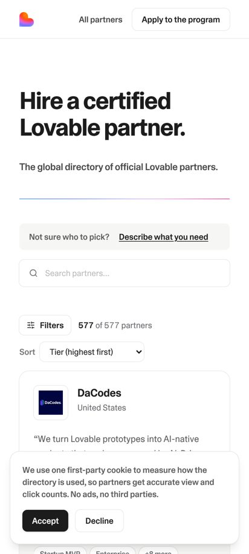 top + cookie notice | 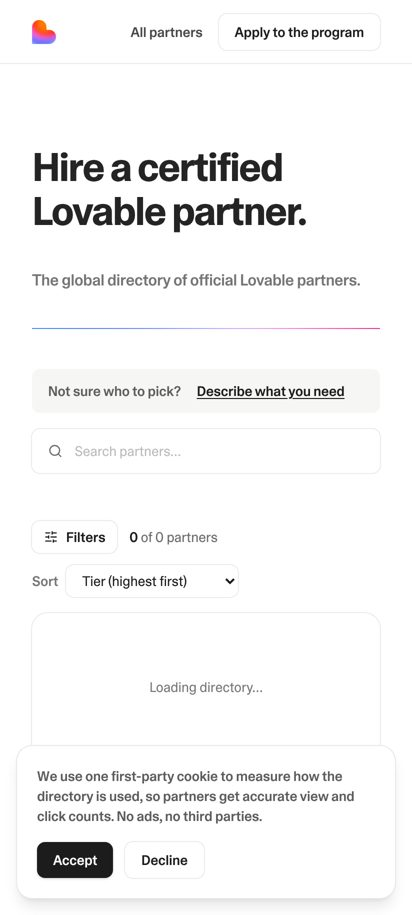 loading ("0 of 0" = don't copy) | 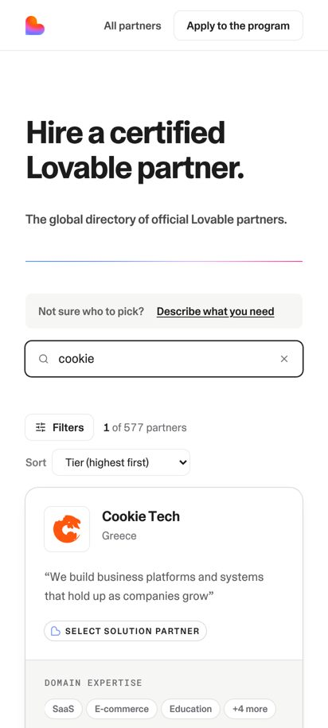 search in the address + clear × | 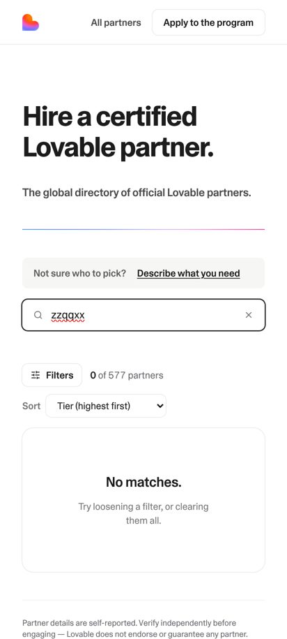 empty (no button = don't copy)    |
| 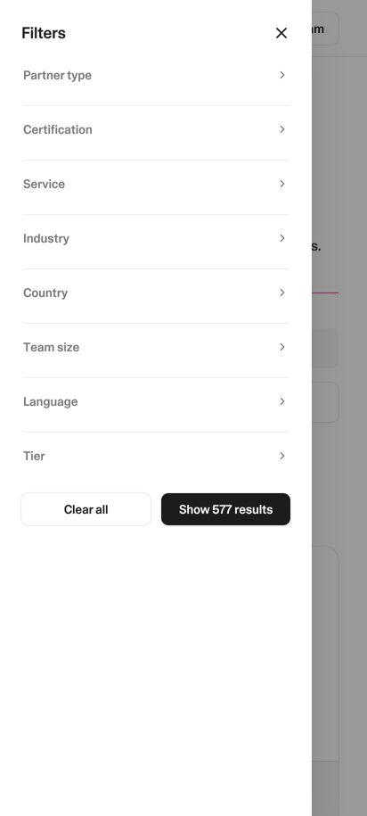 filters panel              | 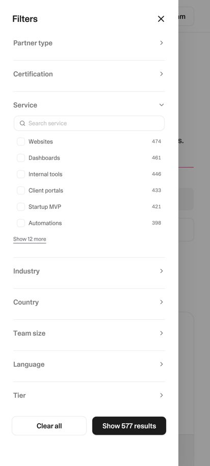 group open: search + counts    | 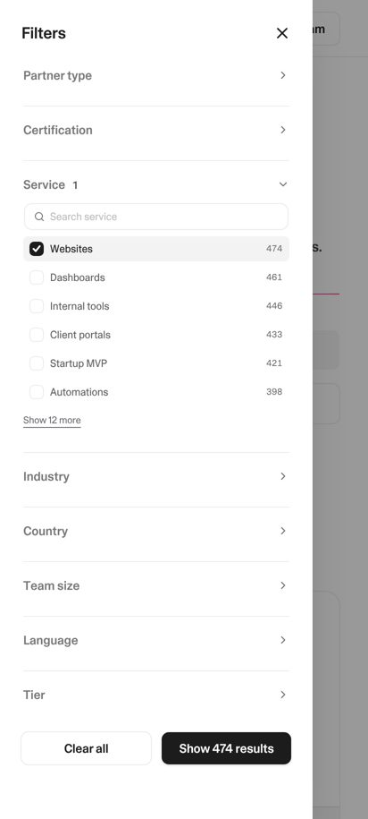 live "Show N results"  | 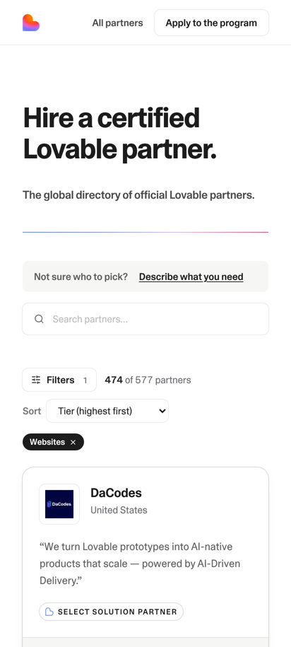 "Filters 1" + removable chip |

| Matcher and voice                                          |                                                                          |                                           |                                                            |
| ---------------------------------------------------------- | ------------------------------------------------------------------------ | ----------------------------------------- | ---------------------------------------------------------- |
| 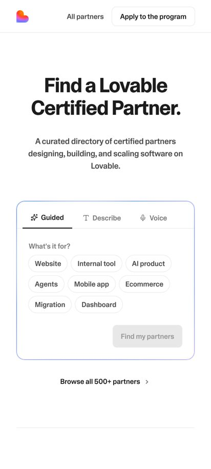 Guided, button disabled | 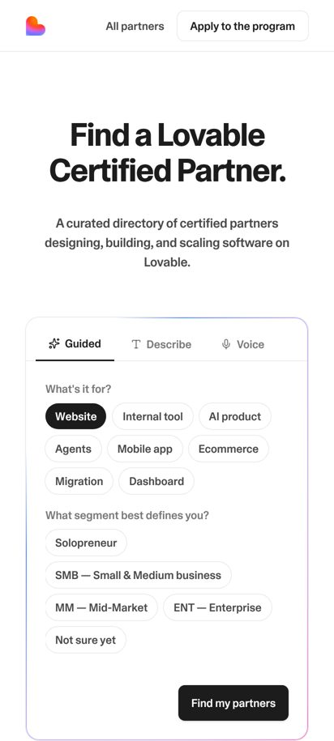 next question appears in place |  voice idle | 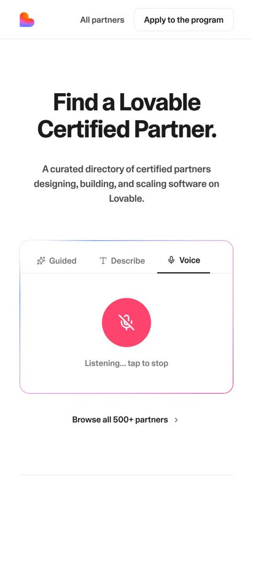 listening (red, pulse) |

| Profile                                            |                                                              |                                                                             |     |
| -------------------------------------------------- | ------------------------------------------------------------ | --------------------------------------------------------------------------- | --- |
| 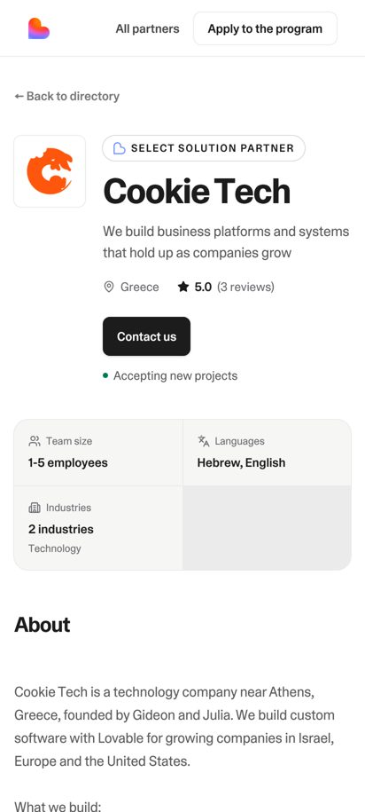 header + fact grid | 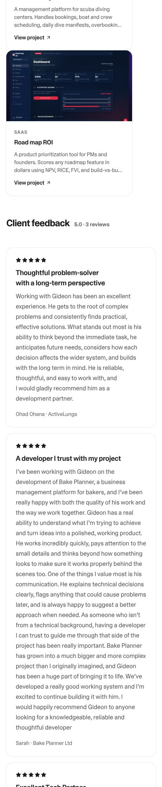 project cards + reviews | 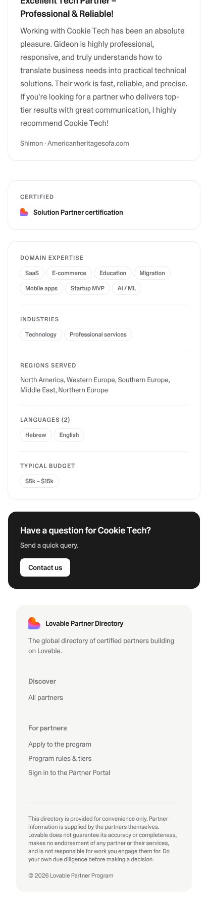 chip groups + dark Message card |     |

| Forms                                                                       |                                           |                                                              |                                                   |
| --------------------------------------------------------------------------- | ----------------------------------------- | ------------------------------------------------------------ | ------------------------------------------------- |
| 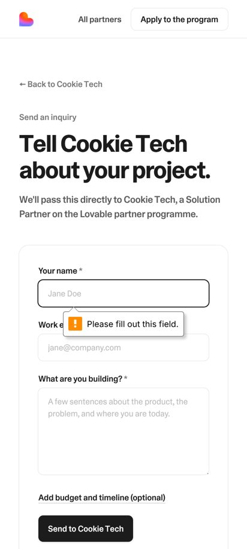 enquiry form (browser bubble = don't copy) | 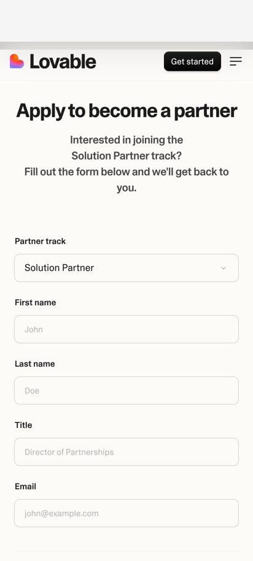 apply form | 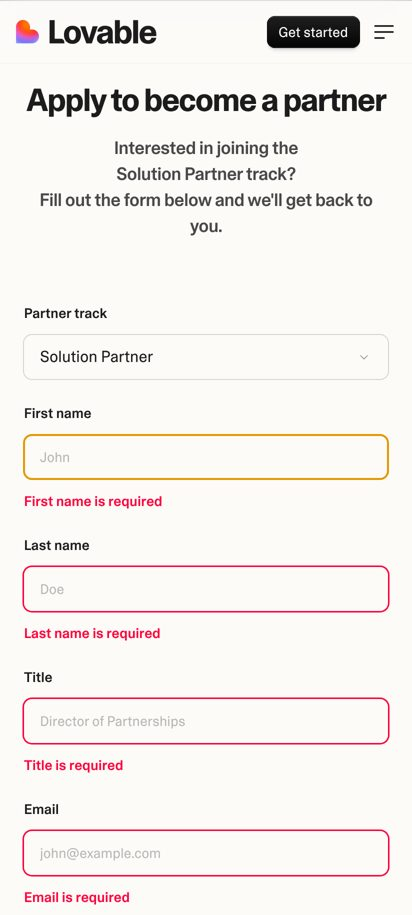 inline errors = copy | 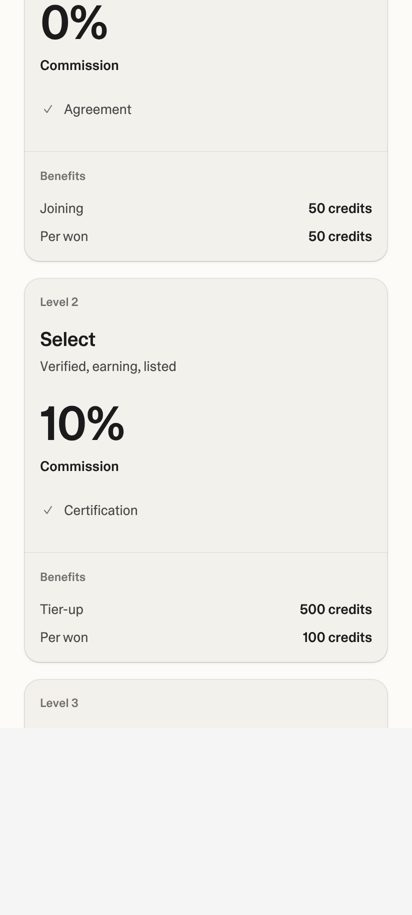 tier cards (Plans) |

| People and events                                                       |                                                                |                                                                           |     |
| ----------------------------------------------------------------------- | -------------------------------------------------------------- | ------------------------------------------------------------------------- | --- |
| 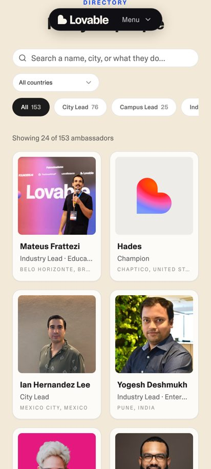 chips with counts + 2-column grid | 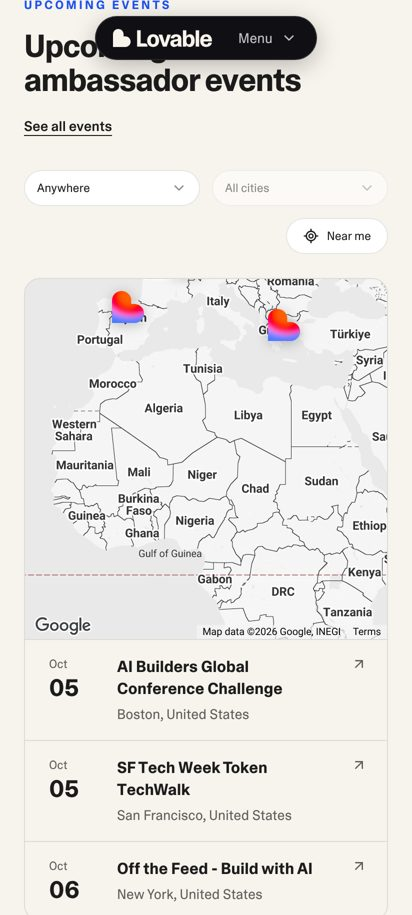 map above list + date rows |  quick look (16px close = don't copy) |     |
